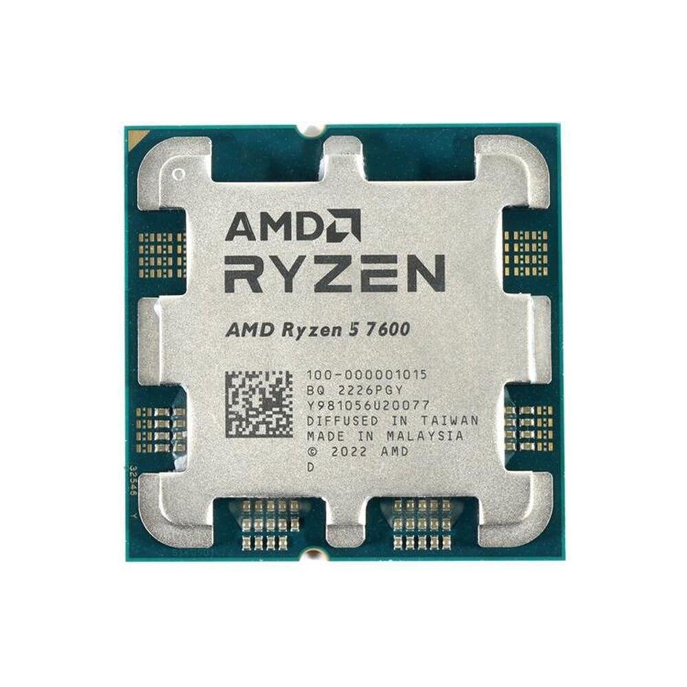
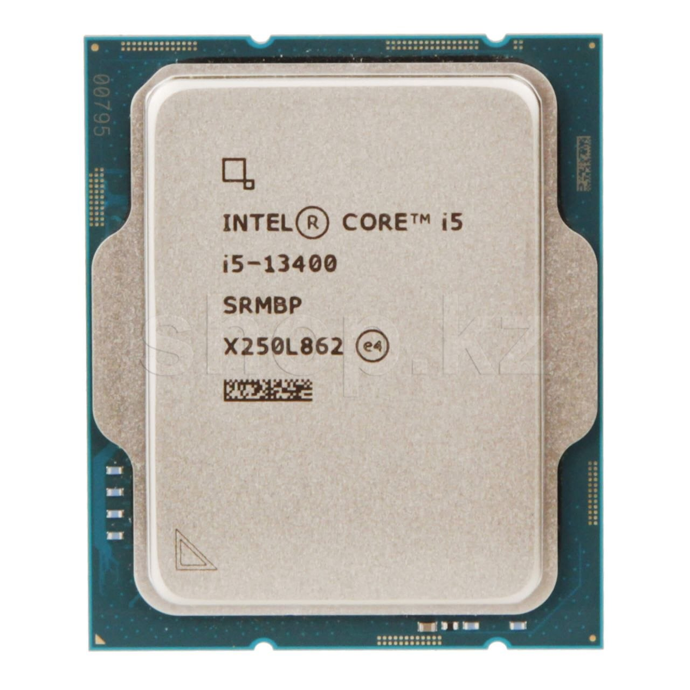
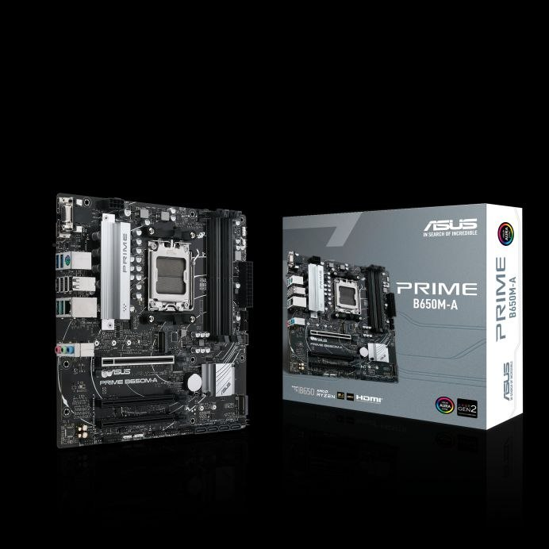
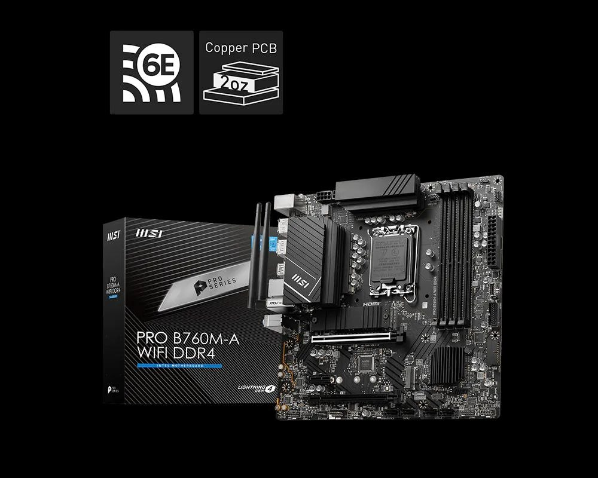
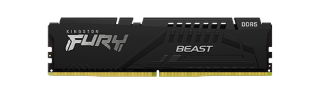
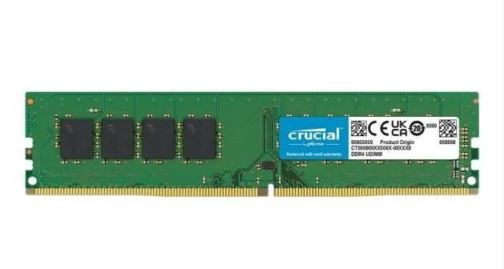
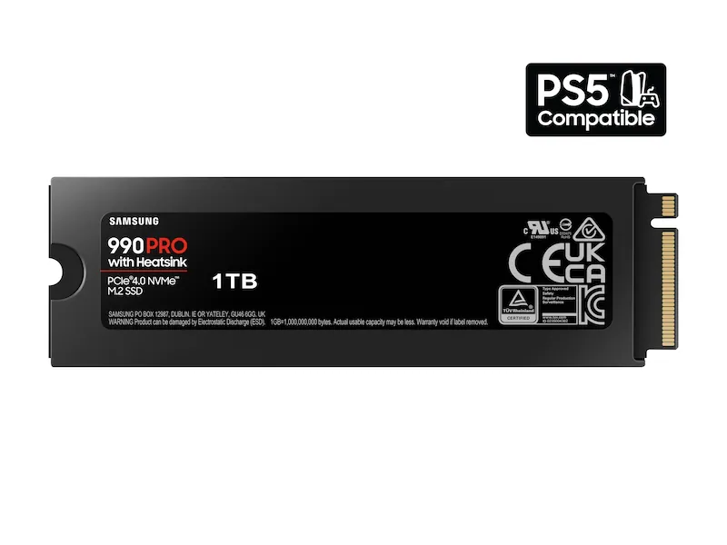
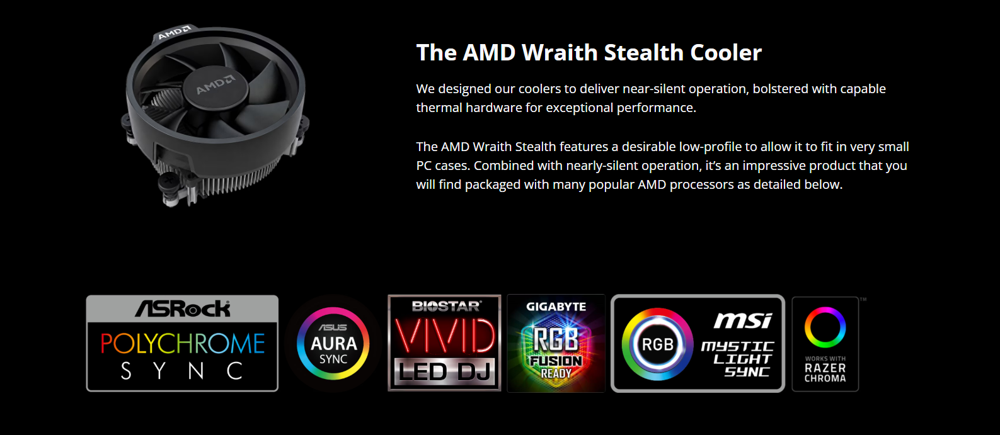
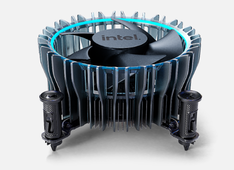

# Lab 3 — Teardown, and the same machine from the command line

Pair: Dinmukhamed + Amira

Machine: Windows 11 Host / Ubuntu VM

Date: 08.11.2026

## What I did

1. **Looked up specs for 10 hardware parts** on official sites (AMD, Intel, ASUS, MSI, Kingston, Crucial, Samsung, Corsair) to check compatibility, connections, and limits
2. **Saved photos of each component** to `evidence/photos/` and described how they connect to other parts and what limits they have
3. **Designed two working PC builds** and checked socket, chipset, and memory support
4. **Ran terminal commands on the Windows 11 host** using PowerShell:
   `Get-CimInstance Win32_Processor`, `Get-CimInstance Win32_PhysicalMemory`, `Get-PhysicalDisk`, `Get-Volume C`, `$env:PROCESSOR_ARCHITECTURE`
5. **Ran terminal commands inside the Ubuntu VM** using Linux CLI:
   `lscpu`, `free -h`, `sudo dmidecode -t memory`, `lsblk -d -o NAME,MODEL,ROTA,TRAN,SIZE`, `df -h /`, `uname -m`
6. **Saved the command outputs** to `evidence/windows-specs.txt` and `evidence/linux-specs.txt`
7. **Created a comparison table** to analyze how VirtualBox hides physical hardware (virtual SATA drive, fewer cores, restricted RAM)

## Part 1 — Ten parts

All facts below come from the makers' websites (amd.com, intel.com, asus.com, msi.com, kingston.com, crucial.com, samsung.com, corsair.com) and, for the two motherboards, from the makers' user guides (ASUS PRIME B650M-A manual, MSI PRO B760M-A WIFI DDR4 user guide). The photos are in `evidence/photos/`.

### 1. AMD Ryzen 5 7600

6 cores / 12 threads, base clock 3.8 GHz, boost up to 5.1 GHz, 32 MB L3 cache, default TDP 65 W, integrated AMD Radeon Graphics. **Connects to** socket AM5; the memory controller has 2 channels of DDR5 (AMD lists up to DDR5-5200 with two modules). **Limit:** fits only AM5 boards and works only with DDR5, not DDR4. A boxed 7600 includes the AMD Wraith Stealth cooler.
Source: https://www.amd.com/en/products/processors/desktops/ryzen/7000-series/amd-ryzen-5-7600.html

### 2. Intel Core i5-13400

10 cores (6 Performance + 4 Efficient) / 16 threads, P-core base clock 2.5 GHz, turbo up to 4.6 GHz, 20 MB Intel Smart Cache, processor base power 65 W (maximum turbo power 148 W), integrated Intel UHD Graphics 730. **Connects to** socket LGA1700; the memory controller supports DDR4 up to 3200 MT/s or DDR5 up to 4800 MT/s, 2 channels. **Limit:** fits only LGA1700 boards, and the board decides whether the system uses DDR4 or DDR5. A boxed i5-13400 includes the Intel Laminar RM1 cooler.
Source: https://www.intel.com/content/www/us/en/products/sku/230495/intel-core-i513400-processor-20m-cache-up-to-4-60-ghz/specifications.html

### 3. ASUS PRIME B650M-A

Micro-ATX board (9.6 x 9.6 in) on the AMD B650 chipset. **Connects to** socket AM5 (the manual names Ryzen 7000 series; the CPU Support list on asus.com also shows Ryzen 8000 and 9000), 4 DDR5 DIMM slots in two channels (A1+A2, B1+B2; a single module goes in DIMM_A2), 2 M.2 Key M slots (M.2_1 PCIe 5.0 x4 from the CPU, M.2_2 PCIe 4.0 x4 from the chipset, both take 2242/2260/2280), 4 SATA 6 Gb/s ports, the 24-pin ATX and 8-pin +12 V power connectors from the PSU, a 4-pin CPU fan header, and HDMI, DisplayPort and VGA outputs. **Limit:** accepts only AM5 processors and only DDR5 memory (the DDR5 notch is different, so DDR4 modules do not fit).
Source: https://www.asus.com/motherboards-components/motherboards/prime/prime-b650m-a/helpdesk_qvl_cpu?model2Name=PRIME-B650M-A

### 4. MSI PRO B760M-A WIFI DDR4

Micro-ATX board (9.6 x 9.6 in) on the Intel B760 chipset. **Connects to** socket LGA1700 (14th, 13th and 12th Gen Intel Core, Pentium Gold, Celeron), 4 DDR4 DIMM slots (up to 128 GB, dual channel, 2133/2666/3200 by JEDEC, higher speeds only by overclocking; fill DIMMA2 first), 2 M.2 Key M slots (M2_1 from the CPU, M2_2 from the chipset, both PCIe 4.0 x4 and 2242/2260/2280; M2_2 can also run a SATA M.2 drive), 4 SATA 6 Gb/s ports (SATA8 is disabled when an M.2 SATA SSD is in M2_2; one SATA cable is in the box), a Wi-Fi 6E module in the M.2 Key-E slot, the 24-pin ATX, 8-pin +12 V and 4-pin ATX 12 V power connectors, a 4-pin CPU fan header, and 2 HDMI and 2 DisplayPort outputs. **Limit:** accepts only LGA1700 processors and only DDR4; DDR5 modules do not fit.
Source: https://www.msi.com/Motherboard/PRO-B760M-A-WIFI-DDR4/Specification

### 5. Kingston FURY Beast DDR5-5600, 16 GB (single module)

DDR5 desktop DIMM (288-pin), 16 GB, 5600 MT/s, CL40, Intel XMP 3.0 profile. **Connects to** a DDR5 DIMM slot on a DDR5 board; one module means single-channel operation. **Limit:** fits only DDR5 boards (the notch location blocks DDR4 slots). The profile is Intel XMP; the default speed comes from the module's SPD, and on an AM5 board the 5600 profile is turned on in BIOS (ASUS offers AEMP for modules without EXPO). AMD specifies the Ryzen 5 7600 itself up to DDR5-5200.
Source: https://www.kingston.com/ru/memory/gaming/kingston-fury-beast-ddr5-memory?speed=5600mt%2Fs&total%20(kit)%20capacity=8gb&kit=single%20module&cas%20latency=40&dram%20density=16gbit&profile%20type=intel%20xmp&color=black

### 6. Crucial DDR4-3200, 16 GB DIMM (CT16G4DFRA32A)

DDR4 desktop memory module (288-pin UDIMM), 16 GB, 3200 MT/s, CL22, 1.2 V. **Connects to** a DDR4 DIMM slot on a DDR4 board. **Limit:** fits only DDR4 boards; the keying notch makes DDR5 slots impossible. 3200 MT/s equals the DDR4 maximum of the i5-13400.
Source: https://www.crucial.com/memory/ddr4/ct16g4dfra32a

### 7. Samsung 990 PRO 1 TB with Heatsink

1 TB NVMe SSD, PCIe 4.0 x4, M.2 2280 with heatsink, sequential read up to 7,450 MB/s and write up to 6,900 MB/s. **Connects to** an M.2 (Key M) slot with NVMe support. **Limit:** speed is capped by the PCIe 4.0 bus (it also works in a PCIe 5.0 slot, at Gen 4 speed), and the heatsink needs vertical clearance above the slot.
Source: https://www.samsung.com/us/memory-storage/nvme-ssd/990-pro-w-heatsink-pcie-4-0-nvme-ssd-1tb-sku-mz-v9p1t0cw/

### 8. Samsung 870 EVO 1 TB 2.5" SATA

1 TB SATA III SSD, 2.5-inch, sequential read up to 560 MB/s and write up to 530 MB/s. **Connects to** a SATA port on the board through a data cable, plus a SATA power cable from the PSU. **Limit:** the SATA 6 Gb/s bus tops out at about 550–560 MB/s.
Source: https://www.samsung.com/us/memory-storage/sata-ssd/870-evo-sata-2-5-ssd-1tb-sku-mz-77e1t0b-am/

### 9. Corsair RM750e (750 W)

750 W fully modular ATX power supply, 80 PLUS Gold, low-noise fan, ATX 3.x / PCIe 5.x compliant. **Connects to** the AC outlet and supplies DC power to the board (24-pin ATX and CPU/EPS connectors), the graphics card (PCIe) and drives (SATA). **Limit:** total continuous output is 750 W.
Source: https://www.corsair.com/ww/en/p/psu/cp-9020295-na/rme-series-rm750e-fully-modular-low-noise-atx-power-supply-cp-9020295-na

### 10. Stock cooler — both processors ship with one

Both processors come with a cooler in the box, so this part has two entries: the AMD Wraith Stealth (with the Ryzen 5 7600) and the Intel Laminar RM1 (with the boxed Core i5-13400). Tray and "F" versions have no cooler.

#### 10a. AMD Wraith Stealth

Low-profile air cooler without LED, shipped in the box with the Ryzen 5 7600 (and with a number of other AMD processors). **Connects to** the processor's socket mounting (AM5 here; AMD also bundles it with AM4 processors) and to a 4-pin PWM fan header (the CPU fan header on the ASUS board). **Limit:** it is the stock cooler of 65 W-class processors such as the 7600; AMD's page gives no separate watt rating, so it is not meant for heavy overclocking.
Source: https://www.amd.com/en/products/processors/ecosystem/cpu-cooler-solutions.html

#### 10b. Intel Laminar RM1

Standard-size air cooler with an aluminum fin heatsink and a copper base, a PWM-controlled variable-speed fan, up to 100 x 100 mm, up to 47 mm tall, up to 350 g. Intel ships it in the box with boxed 12th, 13th and 14th Gen Core desktop processors, including the i5-13400, and does not sell it separately. **Connects to** the LGA1700 socket mounting and to a 4-pin fan header (CPU_FAN1 on the MSI board). **Limit:** Intel rates it for processors up to 65 W TDP; the i5-13400's base power is 65 W but its maximum turbo power is 148 W, so sustained heavy load goes beyond the cooler's rating.
Source: https://www.intel.com/content/www/us/en/support/articles/000089190/processors/intel-core-processors.html

## Two builds

### The motherboards

| | ASUS PRIME B650M-A | MSI PRO B760M-A WIFI DDR4 |
| --- | --- | --- |
| Socket | AM5 | LGA1700 |
| Chipset | AMD B650 | Intel B760 |
| Form factor | micro-ATX, 9.6 x 9.6 in | micro-ATX, 9.6 x 9.6 in |
| Memory type and slots | DDR5, 4 DIMM slots, dual channel, up to 128 GB, EXPO supported | DDR4, 4 DIMM slots, dual channel, up to 128 GB, JEDEC 2133/2666/3200 |
| Storage connections | 2 x M.2 (M.2_1 PCIe 5.0 x4, M.2_2 PCIe 4.0 x4), 4 x SATA 6 Gb/s | 2 x M.2 (both PCIe 4.0 x4; M2_2 also in SATA mode), 4 x SATA 6 Gb/s |
| Power connectors | 24-pin ATX, 8-pin +12 V | 24-pin ATX, 8-pin +12 V, 4-pin ATX 12 V |
| Video outputs | HDMI, DisplayPort, VGA | 2 x HDMI, 2 x DisplayPort |
| Processors accepted | The manual names Ryzen 7000 series; the CPU Support list also shows Ryzen 8000 and 9000. The Ryzen 5 7600 is on the list. | Intel Core 14th, 13th and 12th Gen, Pentium Gold and Celeron. The i5-13400 is 13th Gen. |
| BIOS update | AMD Socket AM5 for AMD Ryzen™ 9000 & 8000 & 7000 Series Desktop Processors* Supports up to AMD 170W CPU. | Support Intel® Core™ 14th/ 13th/ 12th Gen Processors, Intel® Pentium® Gold and Celeron® Processors LGA 1700. |

### Build 1 — AMD AM5 / DDR5

| Part | Model | Why it fits here |
| --- | --- | --- |
| Processor | AMD Ryzen 5 7600 | Socket AM5 matches the ASUS board, and its memory controller uses DDR5. |
| Motherboard | ASUS PRIME B650M-A | Has socket AM5 and the B650 chipset, and lists the Ryzen 5 7600 in its CPU Support list. |
| Memory | Kingston FURY Beast DDR5-5600, 16 GB | The board takes only DDR5 and this module is DDR5 (the notch blocks DDR4). The single module goes in DIMM_A2. The 7600 officially runs DDR5-5200, so 5600 MT/s comes from a BIOS profile. |
| SSD | Samsung 990 PRO 1 TB with Heatsink | The board has M.2 slots with PCIe 5.0 x4 and PCIe 4.0 x4 that take 2280 drives, so this PCIe 4.0 NVMe drive gets full speed. |
| Power supply | Corsair RM750e | The board needs the 24-pin ATX and the 8-pin +12 V plug; ASUS recommends a PSU of at least 350 W, and 750 W is far above that for a 65 W CPU build. |
| Cooler | AMD Wraith Stealth (part 10a) | Comes in the box with the Ryzen 5 7600, mounts on socket AM5 and plugs into the CPU fan header. |

**What Build 1 still needs to switch on:** a case, a display with a cable (the 7600 has integrated Radeon graphics and the board has HDMI, DisplayPort and VGA outputs, so no graphics card is required), a keyboard, a mouse, and an operating system installed on the SSD. Memory is one module, so it runs in single-channel mode.

### Build 2 — Intel LGA1700 / DDR4

| Part | Model | Why it fits here |
| --- | --- | --- |
| Processor | Intel Core i5-13400 | Socket LGA1700 matches the MSI board, and its memory controller supports DDR4-3200. |
| Motherboard | MSI PRO B760M-A WIFI DDR4 | Has LGA1700 and lists 13th Gen Intel Core; its slots take only DDR4. |
| Memory | Crucial DDR4-3200, 16 GB | The board takes only DDR4, and 3200 MT/s equals both the board's JEDEC speed and the i5-13400's DDR4 maximum. The single module goes in DIMMA2 (MSI says to fill it first). |
| SSD | Samsung 870 EVO 1 TB 2.5" SATA | The board has 4 SATA 6 Gb/s ports and a SATA cable in the box; the drive uses that data cable and SATA power from the PSU. |
| Power supply | Corsair RM750e | The motherboard requires a 24-pin ATX power connector and an 8-pin CPU power connector. The Corsair RM750e (750W, 80+ Gold) provides the required power connections and is more than sufficient for this build with the 65W Intel Core i5-13400 CPU. |
| Cooler | Intel Laminar RM1 (part 10b) | Comes in the box with the boxed i5-13400, mounts on LGA1700, plugs into CPU_FAN1, and is rated by Intel for processors up to 65 W. |

**What Build 2 still needs to switch on:** a case, a display, a keyboard, a mouse, and an operating system installed on the SSD. Video comes from the board's HDMI/DisplayPort and the i5-13400's integrated UHD Graphics 730, so a graphics card is optional. Memory is one module, so it runs in single-channel mode.

## Part 2 — Same facts, three operating systems

Windows (PowerShell) ran on the **host**; Linux (Ubuntu) ran in a **VirtualBox VM** on that same host. Differences between the columns therefore come partly from the operating system and partly from virtualization. macOS is not included: nobody in the pair has a Mac.

| Fact | Windows (PowerShell) — host | Linux (Ubuntu) — VirtualBox VM |
| --- | --- | --- |
| CPU model | `Get-CimInstance Win32_Processor \| Select Name, NumberOfCores, NumberOfLogicalProcessors, MaxClockSpeed` → 13th Gen Intel(R) Core(TM) i5-13450HX | `lscpu` (Model name) → 13th Gen Intel(R) Core(TM) i5-13450HX |
| Cores / threads | same command → 10 cores / 16 logical processors, MaxClockSpeed 2400 MHz | `lscpu` (Core(s) per socket × Thread(s) per core) → 2 cores × 1 thread = 2 threads |
| Total memory | `Get-CimInstance Win32_PhysicalMemory \| Select DeviceLocator, Capacity, Speed, ConfiguredClockSpeed, SMBIOSMemoryType, FormFactor` (Capacity) → 17179869184 bytes = 16 GiB (one module) | `free -h` → 1.6 Gi total |
| Memory modules and speed | same command → 1 module in Controller0-ChannelA-DIMM0, 16 GiB, Speed 5600, ConfiguredClockSpeed 4800, SMBIOSMemoryType 34 (DDR5), FormFactor 12 (SODIMM) | `sudo dmidecode -t memory` → only "SMBIOS 2.5 present."; no memory device entries, so no modules and no speed |
| Disk model and type | `Get-PhysicalDisk \| Select FriendlyName, MediaType, BusType, Size` → KEG70ZNT1T02 LS KIOXIA, SSD, NVMe, 1024209543168 bytes (about 953.9 GiB) | `lsblk -d -o NAME,MODEL,ROTA,TRAN,SIZE` → sda, VBOX HARDDISK, ROTA 1, sata, 25G |
| Free space | `Get-Volume C` → C: 871.64 GB free of 951.46 GB | `df -h /` → 5.3G available of 12G (51 % used), /dev/mapper/ubuntu--vg-ubuntu--lv |
| Architecture (x86-64 / ARM64) | `$env:PROCESSOR_ARCHITECTURE` → AMD64 | `uname -m` → x86_64 |

### Summary

The same facts have different names: Windows says `AMD64` where Linux says `x86_64`; Windows reports `NumberOfCores` and `NumberOfLogicalProcessors` where `lscpu` gives Core(s) per socket and Thread(s) per core; Windows reports the disk as `MediaType SSD` and `BusType NVMe` where Linux uses `ROTA` (1 = rotating, 0 = SSD) and `TRAN`; and sizes are raw bytes in `Get-PhysicalDisk` but human-readable (`25G`, `12G`) with `-h` on Linux. The VM passes the real CPU model through but shows only 2 of the host's 16 threads and 1.6 Gi of its 16 GiB, a virtual 25 GB `VBOX HARDDISK` on a SATA controller with `ROTA 1` instead of the host's NVMe SSD, and `dmidecode` lists no memory module at all, so the real memory (one 16 GiB DDR5 SODIMM) is only visible from the host.

### Notes

- The host has a single memory module, so memory runs in single-channel mode. Its rated speed is 5600, but it runs at a configured 4800.
- `df -h /` measures the 12G logical volume (LVM) the Ubuntu installer created, not the whole 25G virtual disk.
- `lscpu` reports the hypervisor as KVM while the disk is `VBOX HARDDISK`: the VM is VirtualBox, and VirtualBox presents a KVM-compatible paravirtualization interface to Linux guests.

## What did not work the first time

**`sudo dmidecode -t memory` in the VM printed no memory modules.**

- **What I saw:** only two lines, `Getting SMBIOS data from sysfs.` and `SMBIOS 2.5 present.`, with no "Memory Device" blocks, so no size, no speed and no slot names.
- **What it was:** not an error. The VM's virtual firmware tables contain no memory device records, so `dmidecode` has nothing to print. The real memory is only described by the host's firmware.
- **What I did:** ran `Get-CimInstance Win32_PhysicalMemory` on the Windows host, where the module appears (16 GiB, DDR5, SODIMM, 5600 rated, 4800 configured), and wrote down in the table that the VM shows nothing.

**`lsblk` in the VM showed `sda`, not an NVMe disk.**

- **What I saw:** `sda  VBOX HARDDISK  ROTA 1  sata  25G`, although the host disk is an NVMe SSD.
- **What it was:** VirtualBox emulates a SATA disk for the guest and reports it as rotating; the guest cannot see the real NVMe drive behind it.
- **What I did:** took the real disk model and type (`KIOXIA`, SSD, NVMe) from `Get-PhysicalDisk` on the host and recorded the VM's view as a finding.

## Evidence

- [evidence/windows-specs.txt](evidence/windows-specs.txt) — raw PowerShell output of the five Windows commands, captured on the host.
- [evidence/linux-specs.txt](evidence/linux-specs.txt) — raw output of `lscpu`, `free -h`, `sudo dmidecode -t memory`, `lsblk`, `df -h /` and `uname -m`, captured in the Ubuntu VM.
- [evidence/photos/](evidence/photos/) — the makers' photos of the parts (ten parts, with both stock coolers shown).
