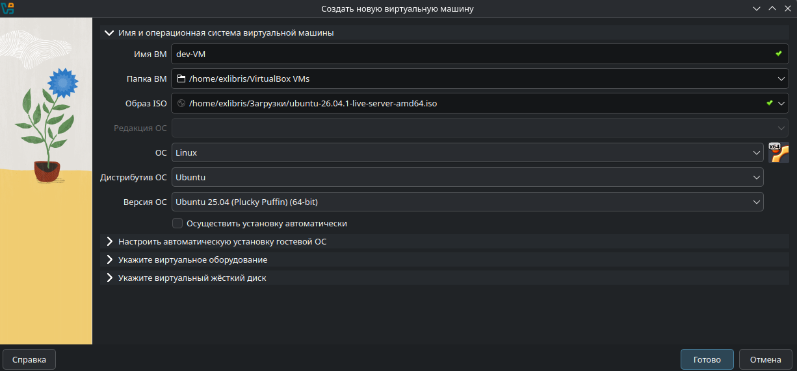
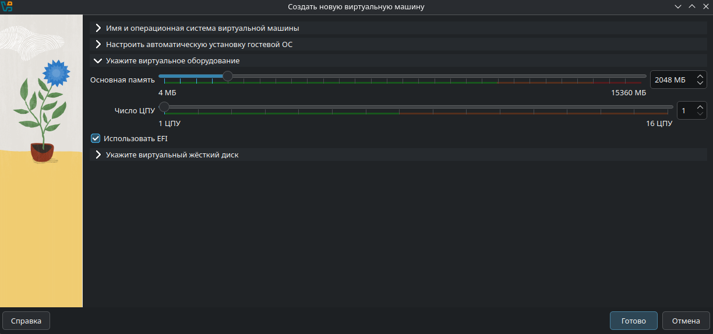
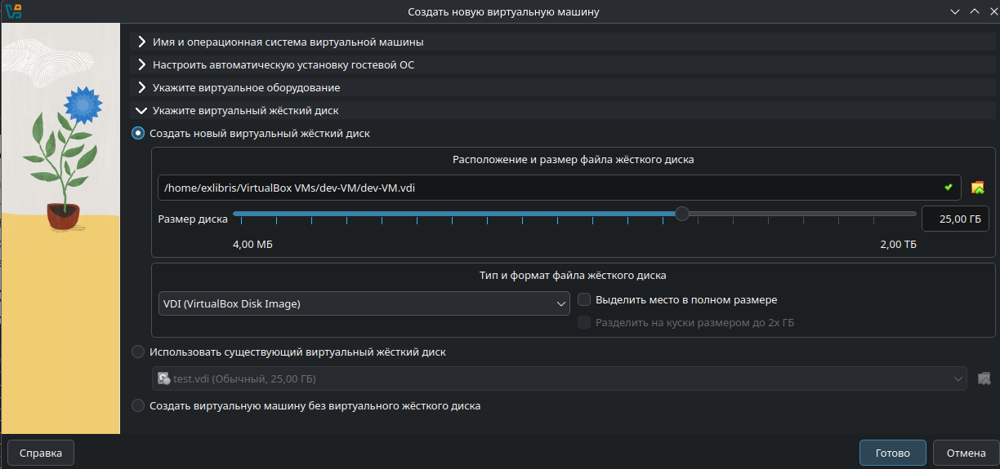
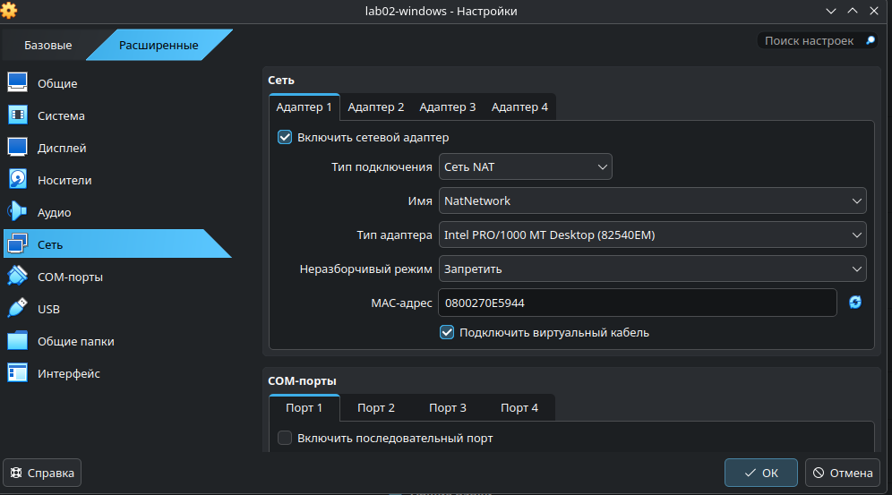
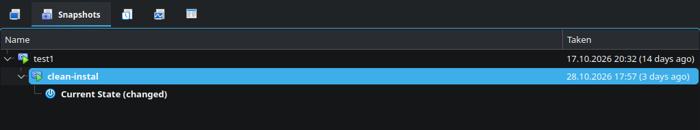

# Step 1 - installing the hypervisor
Go to [virtualbox.org](virtualbox.org) and install with the defaults.

# Step 2 - getting the Ubuntu Server and Windows 11 Enterprise evaluation ISOs
## Ubuntu server
Go to [ubuntu.com/download/server](ubuntu.com/download/server) and download ISO for your architecture.

## Windows 11 Enterprise
Go to [Microsoft Evaluation Center — Windows 11 Enterprise](https://www.microsoft.com/en-us/evalcenter/download-windows-11-enterprise) and download ISO - Enterprise, 64-bit, English (United States).

# Step 3 - creating each VM: CPU, memory, disk, firmware/TPM for Windows

## Ubuntu server
In virtualbox press "New" tnen:
1. Name your VM
2. Choose your ISO (/ubuntu-26.04.1-live-server-amd64.iso)
3. Uncheck "Perform installation automatically"
4. Change "Base Memory" to 1/8 of your RAM
5. Change "Number of CPUs" to 1 or 2 CPU
6. Check "Use EFI" (Recommended)
7. Change "Disk Size" to 25 GB (default)

## Windows 11 Enterprise
In virtualbox press "New" tnen:
1. Name your VM
2. Choose your ISO (/26300.9457.260913-1737.26h2_ge_release_svc_refresh_CLIENTENTERPRISEEVAL_OEMRET_x64FRE_en-us.iso)
3. Uncheck "Perform installation automatically"
4. Change "Base Memory" to 1/8 of your RAM
5. Change "Number of CPUs" to 1 or 2 CPU
6. Check "Use EFI"
7. Change "Disk Size" to 80 GB (default)
8. After you create your windows VM press "Settings" then "System", "TPM Version" change to 2.0

# Step 4 - installing each operating system
## Ubuntu server
Start the VM. Click inside the window to type into it. (To get the mouse back out: Ctrl+Alt (Windows/Linux))

1. Boot menu: Choose (Try or Install Ubuntu Server).
2. Keyboard: English (US).
3. Type of install: Ubuntu Server (not minimized).
4. Network: The network card should get an address automatically (DHCP), something like 192.168.x.x or 10.0.2.5. Continue.
5. Proxy: Leave it empty. 
Mirror: Leave it default and wait for the test to pass.
6. Storage: Use an entire disk. This is the 25 GB virtual disk (your laptop's real disk is safe). Accept the summary and then confirm Continue.
7. Profile:
Your name: Create your name.
Server name: Create your server name, for example ubuntu-server.
Username: Create your login short, lowercase, for example aigerim.
Password: Create password. (Write it down somewhere so you don't forget it, because you will need it every time you start your VM.)
8. Ubuntu Pro: Skip it.
9. SSH: tick Install OpenSSH server, you will use it to copy text out of the VM.
10. Featured server snaps: select nothing. Continue.
11. Wait for Installation complete, then choose Reboot Now. If you see "Please remove the installation medium, then press ENTER", press Enter.
12. Log in with your username and password. Nothing appears while you type the password that is normal.

## Windows 11 Enterprise
1. Start the VM, when you see "Press any key to boot from CD or DVD…", click inside the window and press a key quickly. (If you missed it: Restart the VM and try again.)
2. Language, time format, keyboard: your choice: 1) Next;  2) Install now.
3. If asked for a product key choose: I don't have a product key. Edition: Windows 11 Enterprise (Evaluation).
4. Accept the licence terms, Custom: 1) Install Windows only;  2) Select Drive 0 Unallocated Space;  3) Next. Windows copies files and restarts a few times. Do not press a key at the "boot from CD" prompt again.
5. Setup screens: country, keyboard (skip the second keyboard).
6. Account: On the sign-in screen choose 1) Sign-in options;  2) Domain join instead, then create a local account (name, password, three security questions). (Write it down somewhere so you don't forget it).
7. Privacy settings: Switch everything off - Accept.
8. When the desktop appears, install the guest tools:
VirtualBox: 1) Devices;  2) Insert Guest Additions CD image. In Windows, open: 1) The DVD drive;  2) Run VBoxWindowsAdditions.exe;  3) Defaults;  4) Restart.

# Step 5 - putting both guests on one network, and checking it

1. In Virtualbox, click the "Net" button (located in the left panel). 
2. In "Network Manager," select "NAT Network" at the top, then click the "Create" button, and name your network (in the "Name" field).
3. Then for each VM: 1) Settings;  2) Network;  3) Adapter 1;  4) Attached to: NAT Network. (The same name for both.)

Why NAT and not Bridged: Some networks filters by MAC
address, and a bridged adapter gives the guest its own MAC, which the
network will not accept. Behind NAT the guest goes out using the host's
address and the problem disappears.
> Check: run `ip addr` inside the guest. You should see an address like
> 192.168.x.x, different from the host's.
4. Start Ubuntu VM then use command "ip a" to get ip of Ubuntu Server.
5. In File: 1) Tools; 2) Network Manager; 3) NAT Networks; 4) Your network; 5) Port Forwarding, add a rule: Host Port 2222, Guest IP = Ubuntu's address, Guest Port 22.
6. Windows Defender Firewall blocks incoming echo requests by default. To fix it: Open PowerShell as Administrator ( 1) Start; 2) Right-click PowerShell; 3) Run as administrator) and run: `New-NetFirewallRule -DisplayName "Allow ping in (ICMPv4)" -Protocol ICMPv4 -IcmpType 8 -Direction Inbound -Action Allow`
7. Try pinging between systems to check if its working. Ubuntu to Windows: Open terminal and run: `ping -c 4 192.168.80.131`. Windows to Ubuntu: Open PowerShell and run: `ping 192.168.80.130`.

# Step 6 - taking a clean snapshot, and how to roll back to it
Snapshot needed to roll back your VM if something breaks
## How to take Snapshot
In VirtualBox press "Snapshots" then press "Take"

## How to roll back Snapshot
In VirtualBox press "Snapshots" then find which one do you want to roll back and press "Restore"

# Step 7 - what to do when something typical goes wrong.
If something goes wrong you can roll back to clean snapshot.
