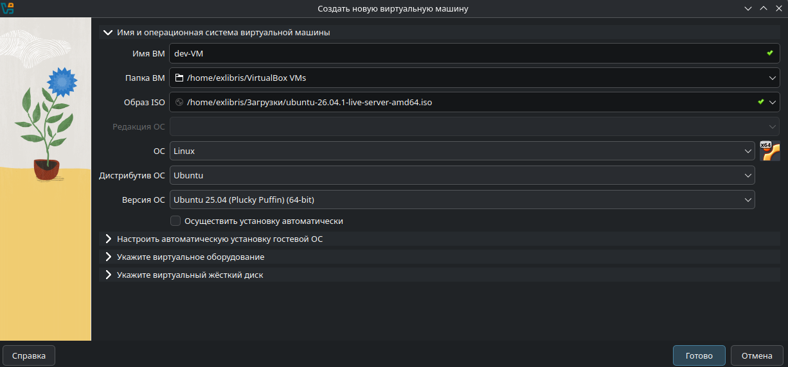
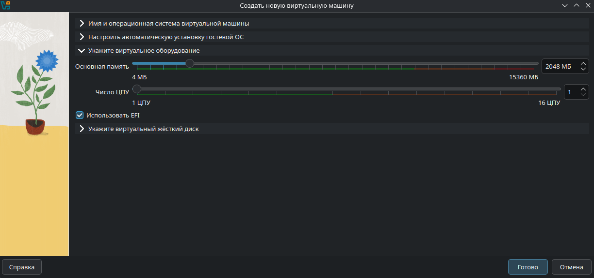
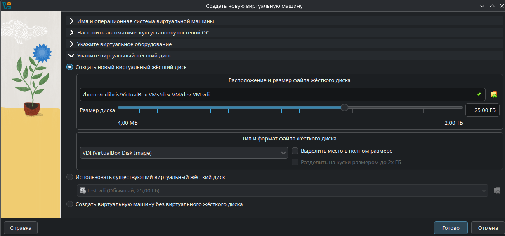
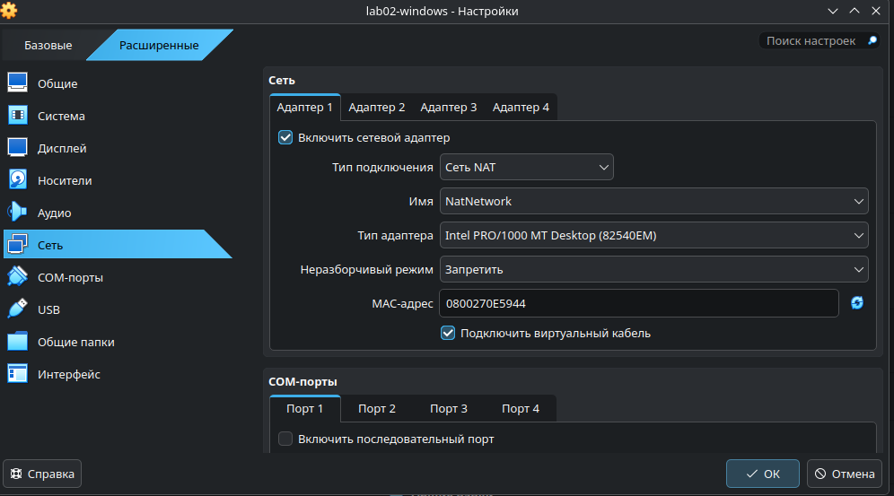
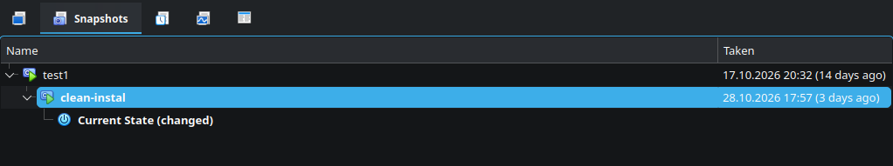

# Build document: test VMs for a new starter (Ubuntu Server + Windows 11)

This document is for Aigerim, so she can build the next one herself. Every step lists what to click and what you should see.

## Step 0 - The host I built this on (and what you need)

| Resource | My host (from the VirtualBox wizard sliders) | Needed for both VMs running at once |
| RAM | 15 360 MB (≈15 GB) | 2 048 MB (Ubuntu) + 4 096 MB (Windows) = 6 144 MB |
| CPUs | 16 | 1 (Ubuntu) + 2 (Windows) = 3 |
| Free disk | heck with `df -h ~` (Linux) or File Explorer (Windows) | 25 GB + 80 GB = 105 GB maximum (disks grow as they fill), plus ≈10 GB for the two ISOs |

> Resource calculation. With both VMs running, the host keeps 15 360 − 6 144 = 9 216 MB of RAM and 13 CPUs for itself, which is enough for a browser and VirtualBox. Rule I used: the VMs together should never take more than half of the host's RAM; below that the host starts swapping and everything gets slow.

If your host is smaller:
- 8 GB host: keep the same values but run only one VM at a time, or give Ubuntu 1 024 MB (it is a server without a desktop and runs fine on 1 GB). Do not go below 4 096 MB for Windows 11, the installer refuses.
- Less than 105 GB free disk: Ubuntu can use 15 GB; Windows 11 needs at least 64 GB.

## Step 1 - installing the hypervisor
Go to [virtualbox.org](virtualbox.org) and install with the defaults.


## Step 2 - getting the Ubuntu Server and Windows 11 Enterprise evaluation ISOs

### Ubuntu server

Go to [ubuntu.com/download/server](ubuntu.com/download/server) and download ISO for your architecture.

Why Ubuntu Server LTS:
- It is free, has 5 years of security updates (LTS), and has no desktop, so it needs little RAM.

### Windows 11 Enterprise

Go to [Microsoft Evaluation Center — Windows 11 Enterprise](https://www.microsoft.com/en-us/evalcenter/download-windows-11-enterprise) and download ISO - Enterprise, 64-bit, English (United States).

Why the evaluation edition:

- It is free and legal for testing, and needs no product key, so we don't spend a company licence on a machine that may be thrown away.
- It is a full Enterprise build, the same edition used on company PCs.
- Limit: it expires 90 days after installation. After that it shuts down every hour. For a starter who only needs to try things, that is fine: rebuild it from this document. If he needs it longer, buy a licence and enter the key instead.
- It is not for production use (licence terms).

## Step 3 - creating each VM: CPU, memory, disk, firmware/TPM for Windows





### Ubuntu server

In virtualbox press "New" tnen:
1. Name: e.g. dev-VM.
2. ISO image: choose ubuntu-26.04.1-live-server-amd64.iso. VirtualBox may show "Ubuntu 25.04 (64-bit)" as the version because it does not know 26.04 yet. That is fine, leave it.
3. Uncheck "Perform unattended installation" (we install by hand so we see each choice).
4. Base Memory: 2048 MB.
5. Processors: 1.
6. Enable EFI: ticked.
7. Hard disk: Create a new virtual hard disk, 25 GB, VDI, "Pre-allocate full size" unticked (dynamically allocated).
8. Press Finish.

### Windows 11 Enterprise

In virtualbox press "New" tnen:
1. Name your VM
2. Choose your ISO (/26300.9457.260913-1737.26h2_ge_release_svc_refresh_CLIENTENTERPRISEEVAL_OEMRET_x64FRE_en-us.iso)
3. Uncheck "Perform installation automatically"
4. Change "Base Memory" to 1/8 of your RAM
5. Change "Number of CPUs" to 1 or 2 CPU
6. Check "Use EFI"
7. Change "Disk Size" to 80 GB (default)
8. After you create your windows VM press "Settings" then "System", "TPM Version" change to 2.0

## Step 4 - installing each operating system

> Mouse captured? VirtualBox takes the mouse and keyboard when you click inside a VM window. To get them back press the Host key, which is the right Ctrl key by default (shown in the bottom-right corner of the VM window).

### Ubuntu server

Start the VM. Click inside the window to type into it. (To get the mouse back out: Ctrl+Alt (Windows/Linux))

1. Boot menu: Try or Install Ubuntu Server.
2. Keyboard: English (US).
3. Type of install: Ubuntu Server (not minimized).
4. Network: the card gets an address automatically (DHCP), something like 10.0.2.15. Continue. (The address changes later when we move the VM to the NAT Network in Step 5.)
5. Proxy: leave empty. Mirror: leave the default and wait for the test to pass.
6. Storage: Use an entire disk. This is the 25 GB virtual disk; your real disk is not touched. Accept the summary and confirm Continue.
7. Profile:
- *Your name: e.g. Aigerim
- *Server name: e.g. ubuntu-server
- *Username: short and lowercase, e.g. aigerim
- *Password: write it down, you need it every time you log in.
8. Ubuntu Pro: Skip for now.
9. SSH: tick Install OpenSSH server. We use it to copy text out of the VM.
10. Featured server snaps: select nothing. Continue.
11. Wait for Installation complete, then Reboot Now. If you see "Please remove the installation medium, then press ENTER", press Enter.
12. Log in with your username and password. Nothing appears while you type the password; that is normal.

### Windows 11 Enterprise

1. Start the VM. When you see "Press any key to boot from CD or DVD…", click inside the window and press a key quickly. (Missed it? Machine - Reset, and try again.)
2. Language, time format, keyboard: your choice - Next - Install now.
3. Product key: I don't have a product key. Edition: Windows 11 Enterprise Evaluation.
4. Accept the licence terms - Custom: Install Windows only - select Drive 0 Unallocated Space - Next. Windows copies files and restarts a few times. Do not press a key at the "boot from CD" prompt again.
5. Setup screens: country, keyboard (skip the second keyboard).
6. Account: Sign-in options - Domain join instead, then create a local account (name, password, three security questions). Write the password down.
7. Privacy settings: switch everything off - Accept.
8. When the desktop appears, install the Guest Additions (better screen size, shared clipboard, smoother mouse): VirtualBox menu Devices - Insert Guest Additions CD image. In Windows open the DVD drive → run VBoxWindowsAdditions.exe - accept the defaults - Restart.

## Step 5 - putting both guests on one network, and checking it

### 5.1 Create the NAT Network

1. In VirtualBox: **File** - **Tools** - **Network Manager**.
2. Tab **NAT Networks** - **Create**. Name it e.g. `NatNetwork`. Leave the default prefix `10.0.2.0/24` and DHCP enabled.

### 5.2 Attach both VMs to it

For **each** VM: **Settings** - **Network** - **Adapter 1** - **Attached to: NAT Network** - **Name: NatNetwork** (the same name for both).



> Why NAT Network (and not the other modes): see the [decisions table](#decisions-non-default-settings-and-why).

### 5.3 Find each guest's address

- **Ubuntu:** run `ip a`. Look at the `inet` line of the network card (e.g. `enp0s3`). In my build: **`10.0.2.5`**.
- **Windows:** in PowerShell run `ipconfig`. Look at "IPv4 Address". In my build: **`10.0.2.3`**.

> Both addresses must start with `10.0.2.` (the NAT Network prefix). If one starts with anything else, that VM is not attached to the NAT Network: repeat 5.2.
> Your addresses can differ from mine; DHCP hands them out in the order the VMs start. Always use the addresses you see, not the ones in this document.

### 5.4 Allow ping into Windows

Windows Defender Firewall blocks incoming ping (ICMP echo requests) by default. Open PowerShell as Administrator (Start - right-click **PowerShell** - **Run as administrator**) and run:

```powershell
New-NetFirewallRule -DisplayName "Allow ping in (ICMPv4)" -Protocol ICMPv4 -IcmpType 8 -Direction Inbound -Action Allow
```

### 5.5 Check the connection (four directions)

| From | Command | Expected |
|---|---|---|
| Ubuntu - Windows | `ping -c 4 10.0.2.3` | 4 received, 0% packet loss |
| Ubuntu - internet | `ping -c 4 ubuntu.com` | 4 received |
| Windows - Ubuntu | `ping 10.0.2.5` | 4 replies, 0% loss |
| Windows - internet | `ping ubuntu.com` | 4 replies |

The output from my build is in [evidence/05-ping-between-guests.txt](evidence/05-ping-between-guests.txt).

### 5.6 SSH into Ubuntu from the host (to copy text out)

Guests on a NAT Network cannot be reached from the host directly, so we forward one port.
 
1. **File** - **Tools** - **Network Manager** - **NAT Networks** - `NatNetwork` - **Port Forwarding** - **+**.
2. Rule: Name `ssh`, Protocol TCP, Host IP *(empty)*, **Host Port 2222**, Guest IP **10.0.2.5** (Ubuntu's address from 5.3), **Guest Port 22**.
3. From the host terminal:
```bash
   ssh -p 2222 aigerim@127.0.0.1
```
   Copy a file out of the VM:
```bash
   scp -P 2222 aigerim@127.0.0.1:~/04-guest-uname.txt .
```

## Step 6 - taking a clean snapshot, and how to roll back to it

A snapshot saves the whole VM (disk + settings) at one moment. If the new starter breaks something, you go back to it in a minute instead of reinstalling.

### Take the clean snapshot

1. Finish Steps 4–5, then **shut the VM down** (Ubuntu: `sudo poweroff`; Windows: Start - Shut down). A snapshot of a powered-off VM is smaller and safer.
2. Select the VM - **Snapshots** - **Take**.
3. Name: `clean-install`. Description: date and what is inside (e.g. "fresh install + Guest Additions + firewall rule").
Do this for **both** VMs.

### How to roll back Snapshot

1. Shut the VM down.
2. **Snapshots** - select `clean-install` - **Restore**.
3. VirtualBox asks whether to save the current state as a new snapshot first. Tick it if you might want the broken state later; otherwise untick.
4. Start the VM. Everything done after the snapshot is gone.


## Step 7 - what to do when something typical goes wrong.

| Symptom | Cause | Fix |
|---|---|---|
| VM won't start: *"VT-x/AMD-V hardware acceleration is not available"* | Virtualisation is off in the host's BIOS/UEFI | Reboot the host, enter BIOS/UEFI setup, enable **Intel VT-x** / **AMD-V (SVM)**. |
| Linux host: *"VirtualBox can't operate in VMX root mode"* | KVM is already using the CPU's virtualisation | Close other hypervisors, or run `sudo modprobe -r kvm_intel kvm_amd` and start the VM again. |
| Windows host: VM is very slow, green turtle icon in the status bar | Hyper-V / WSL2 is using the CPU | Accept it, or turn off Hyper-V / "Virtual Machine Platform" in Windows Features and reboot. |
| Windows installer: *"This PC can't run Windows 11"* | TPM, Secure Boot, RAM or disk below requirements | Settings - System: TPM **v2.0**, **Secure Boot** on, RAM ≥ **4096 MB**; disk ≥ **64 GB**. |
| Windows VM shows "Press any key…" and then a black screen / UEFI shell | The key wasn't pressed in time | Machine - Reset and press a key immediately. |
| Ubuntu reboots straight back into the installer | ISO is still attached | Power off - Settings - Storage - select the optical drive - **Remove disk from virtual drive**. |
| Mouse or keyboard "stuck" in the VM | VM captured input | Press the Host key (right **Ctrl**). |
| Windows screen is tiny / won't resize | Guest Additions missing | Step 4, Windows item 8. |
| Guest address isn't `10.0.2.x` / guests can't ping each other | VM not on the NAT Network, or on a different one | Settings - Network: both on **NAT Network** with the **same name**. |
| Ubuntu - Windows ping times out, Windows - Ubuntu works | Windows firewall blocks ICMP | Run the firewall rule from 5.4. |
| `ssh -p 2222 …` says *Connection refused* or hangs | Ubuntu's address changed, or forwarding rule is wrong | Check `ip a` in Ubuntu; update the Guest IP in the port-forwarding rule. |
| Windows shuts down every hour, desktop says licence expired | 90-day evaluation is over | Rebuild from this document, or enter a purchased key. |
| Something inside a VM is broken and you don't know why | — | Restore the `clean-install` snapshot (Step 6). |
 
---

## Decisions: non-default settings and why

| Setting | Default | What I chose | Why |
|---|---|---|---|
| Ubuntu RAM | 2048 MB (wizard default) | 2048 MB | No desktop; 2 GB is comfortable for a server, keeps host RAM free. |
| Windows RAM | 2048 MB | **4096 MB** | Windows 11 minimum is 4 GB; the installer refuses less. |
| Windows CPUs | 1 | **2** | Windows 11 minimum is 2 cores; 1 core is also painfully slow. |
| Windows disk | 80 GB | 80 GB | Windows 11 needs ≥ 64 GB; 80 GB leaves room for updates and tools. |
| Disk type | Dynamically allocated | Dynamically allocated (kept) | Disk file grows only as it fills, so a 105 GB total doesn't take 105 GB at once. |
| EFI | Off for Ubuntu | **On** for both | Required for Windows 11 (UEFI + Secure Boot); on for Ubuntu too so both VMs are built the same way. |
| TPM / Secure Boot (Windows) | depends on OS type | **TPM 2.0 + Secure Boot on** | Windows 11 hardware requirements. |
| Unattended install | On | **Off** | We want to see and record every installer choice so Aigerim can repeat it. |
| Network mode | NAT | **NAT Network** | See below. |
| SSH port forward | none | **Host 2222 - Ubuntu 22** | Lets us copy command output out of the VM unedited (no retyping). 2222 because port 22 may already be used on the host. |
| Windows firewall | ICMP in blocked | **ICMP echo in allowed** | Needed to prove Ubuntu - Windows connectivity; only ping is opened, nothing else. |
 
**Why NAT Network.** The starter needs three things: (1) the two VMs must talk to each other, (2) both need internet for updates, (3) whatever he breaks must not reach the office network. Comparing the VirtualBox modes against those three:
 
| Mode | VMs see each other | Internet | Isolated from office LAN | Verdict |
|---|---|---|---|---|
| NAT (default) | **No**, each VM gets its own private NAT | Yes | Yes | Fails (1) |
| **NAT Network** | **Yes** | **Yes** | **Yes**, the LAN sees only the host | **Chosen** |
| Bridged | Yes | Yes | **No**, each VM appears on the office LAN with its own MAC and needs its own address from the office DHCP; networks that only allow known MACs block it | Fails (3) |
| Host-only | Yes | **No** | Yes | Fails (2) |
| Internal | Yes | **No** | Yes | Fails (2) |
 
The price of NAT Network is that the host can't reach the guests directly, which is why there is a port-forward for SSH (5.6).
